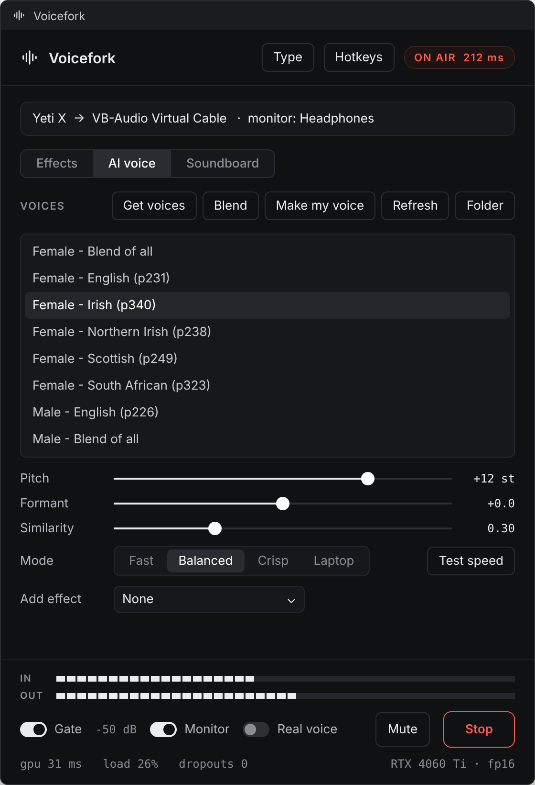

# Voicefork

**A free, open-source alternative to Voicemod.** Real-time AI voices, classic effects and a soundboard
for Discord, OBS and games. No account, no paywall, and it runs 100% on your own PC.

<p align="center"></p>

## Features

- **AI voices (RVC):** sound like a different person in real time. Free starter voices included,
  plus a built-in browser for thousands of community voices on Hugging Face, with previews of
  *your own* voice before you download.
- **Make your own voice:** record about 10 minutes of guided sentences (or import audio) and
  train a voice inside the app. Quick, Standard or Best.
- **Blend** two voices into a new one that doesn't belong to anyone.
- **Effects:** 11 classic presets (deep, robot, radio, cave, 8-bit …) that run on any PC.
- **Soundboard:** drag in clips or record them. Others hear them in your mic, and you hear them too.
- **Type to speak:** a hotkey pops up a box; what you type is spoken in your current voice.
- **Hotkeys:** push-to-talk (keyboard or mouse side buttons) and one key per voice, effect or clip.
  Works inside games.
- **Auto speed test:** picks the best mode for your PC. Laptop mode for PCs without an NVIDIA GPU.
- **Private by design:** your voice never leaves your computer. The only network use is
  downloading models and voices from Hugging Face.

## Install (Windows)

1. Install **[Python 3.12](https://www.python.org/downloads/release/python-3128/)** and tick
   **"Add python.exe to PATH"** in the installer.
2. Download Voicefork (**Code → Download ZIP**, or the latest
   [release](https://github.com/Dank-zz/voicefork/releases)) and unzip it somewhere simple.
3. Double-click **`Start Voicefork.bat`**. The first run installs everything (5-15 minutes; AI
   voices are a big download). After that it opens in seconds.
4. **For Discord/OBS/games:** the app shows a red bar until a virtual mic exists. Click it and follow
   the steps (install the free [VB-CABLE](https://vb-audio.com/Cable/), restart your PC).
   Then in Discord: *Settings → Voice & Video → Input Device → **CABLE Output***, and turn off
   Discord's noise suppression (Krisp), which fights the effects.

**AI voices** run best on an NVIDIA GPU (RTX 20-series or newer). Without one, Voicefork uses
Laptop mode on the processor, with more delay. Effects work on any PC.

<details>
<summary>Manual install / command line</summary>

```
python -m venv .venv
.venv\Scripts\activate
pip install -r requirements.txt
pip install torch==2.7.1 torchaudio==2.7.1 --index-url https://download.pytorch.org/whl/cu128
pip install -r requirements-ai.txt
python -m voicefork gui
```

Command line, no window:

```
python -m voicefork devices                        list audio devices
python -m voicefork run --preset deep              effects, live
python -m voicefork render in.wav out.wav --preset robot
python -m voicefork ai-setup                       download the AI base models (once)
python -m voicefork get-voice                      download free starter voices
python -m voicefork ai "Female - Irish (p340)" --pitch 12
```

Voices live in `%USERPROFILE%\.voicefork\voices\<name>\` (a `.pth`, optionally an `added_*.index`).
</details>

<details>
<summary>macOS / Linux</summary>

Not officially supported yet, but the core works. Use [BlackHole](https://existential.audio/blackhole/)
(macOS) or a PipeWire/PulseAudio null sink (Linux) instead of VB-CABLE. Type to speak needs Windows.
</details>

## How it works

```
mic ─► noise gate ─► AI voice (RVC) or effect chain ─► + soundboard ─► virtual cable ─► Discord / OBS / game
                                                              └──────► your headphones (monitor)
```

AI voices use RVC: HuBERT reads *what* you say, RMVPE/FCPE track your pitch, and the voice model
re-speaks it in the target's timbre. Speed comes from fp16 and CUDA graphs on the GPU and only
re-rendering the newest audio block. Clean joins come from SOLA splicing (blocks are aligned on the
waveform before crossfading, so there are no clicks).

## Use voices responsibly

Only clone or use voices you have permission to use. Don't use Voicefork to impersonate real people,
deceive, or harass. *Make my voice* asks you to confirm that the recordings are of you or that you
have consent. Voice files are loaded with `weights_only=True`, so a malicious model can't run code.

## Roadmap

- [ ] Own virtual audio driver (no VB-CABLE install)
- [ ] ONNX/TensorRT export: smaller install, even lower latency
- [ ] Linux and macOS builds
- [ ] One-file installer

Bug reports and pull requests are welcome; see [issues](https://github.com/Dank-zz/voicefork/issues).

## Credits

- Voice conversion: [RVC-Project](https://github.com/RVC-Project/Retrieval-based-Voice-Conversion-WebUI)
  (MIT). Inference and training code is vendored in `voicefork/ai/rvc_lib` and `voicefork/ai/trainer`.
- Base models (HuBERT, RMVPE, pretrained weights): [lj1995/VoiceConversionWebUI](https://huggingface.co/lj1995/VoiceConversionWebUI) (MIT).
- Pitch tracker: [torchfcpe](https://github.com/CNChTu/FCPE) (MIT).
- Starter voices: [Nekochu/RVC-VCTK_Voice-sample](https://huggingface.co/Nekochu/RVC-VCTK_Voice-sample)
  (Apache-2.0), trained on the [VCTK corpus](https://datashare.ed.ac.uk/handle/10283/3443) by CSTR,
  University of Edinburgh (CC BY 4.0).
- Virtual mic: [VB-CABLE](https://vb-audio.com/Cable/) by VB-Audio (donationware, installed separately).

## License

[MIT](LICENSE). Voicefork is not affiliated with Voicemod.
